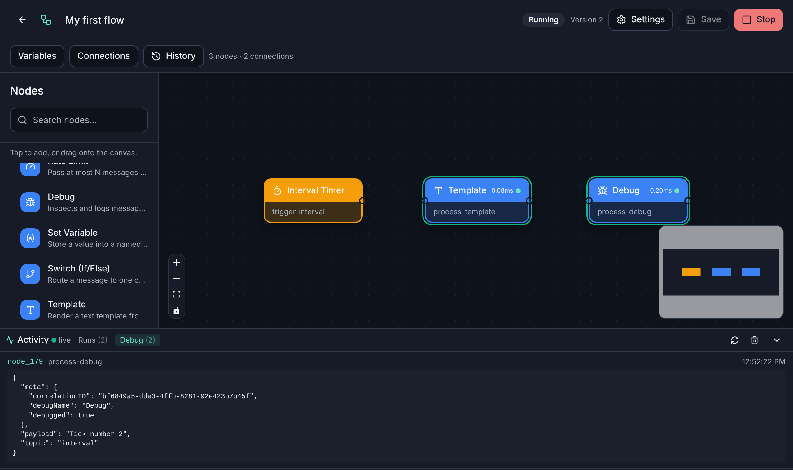

# PiWorker user guide

PiWorker lets you automate things on a Raspberry Pi (or any Linux machine) by
connecting blocks in your browser: *when this happens → do that*. No
programming is needed for most flows.

This guide is for people who **use** PiWorker. If you want to work on PiWorker
itself, see the [README](../../README.md#development-setup).

## Start here

| If you want to… | Read |
|-----------------|------|
| Install PiWorker and build your first flow in ten minutes | [Getting started](getting-started.md) |
| Understand messages, expressions, templates, variables and secrets | [Concepts](concepts.md) |
| Copy a working automation and adapt it | [Recipes](recipes.md) |
| Automate Zigbee sensors, plugs and lights | [Zigbee devices](zigbee.md) |
| Look up a node and its settings | [Node reference](nodes.md) |
| Let Claude or another AI agent use your flows | [AI agents](agents.md) |
| Fix something that does not work | [Troubleshooting](troubleshooting.md) |

## Reference and operations

- [Configuration](../../README.md#configuration): the TOML file, flags and
  environment variables.
- [HTTPS](../../README.md#https): the local certificate authority and custom
  certificates.
- [Operations guide](../operations.md): updates, backups, recovery and
  uninstalling a `piworkerctl` installation.
- [Release notes](../../CHANGELOG.md): what is included and the known limits.

## PiWorker in one picture

A **flow** is a set of **nodes** joined by connections. A **trigger** (orange)
starts it, **processing** nodes (blue) shape or route the message, and
**actions** (purple) do something with it. **Deploy** makes the flow run, and
it keeps running after a reboot until you **Stop** it.
