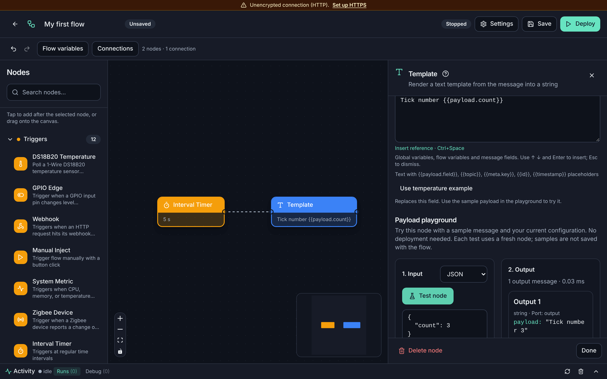
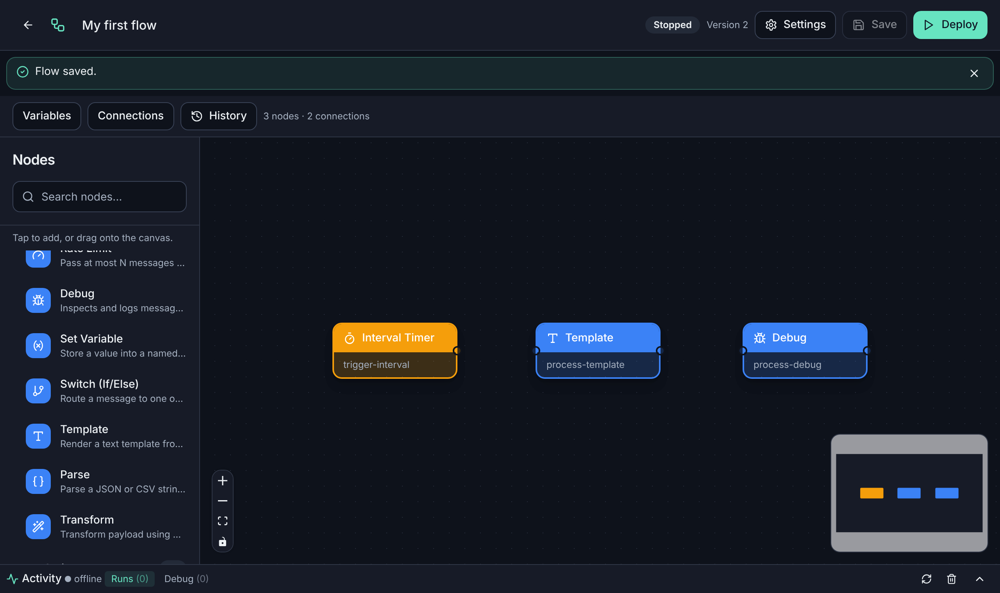
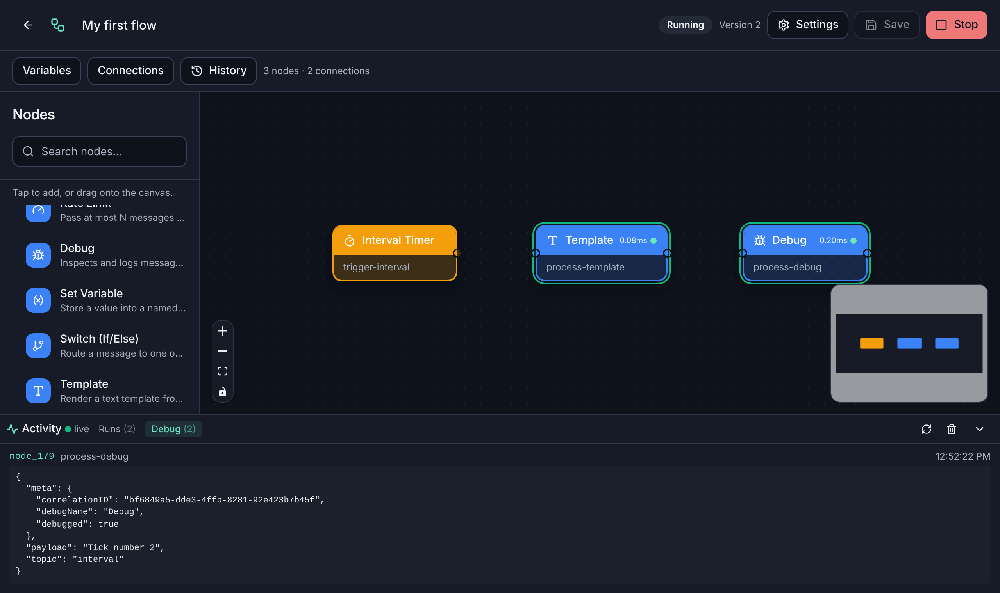
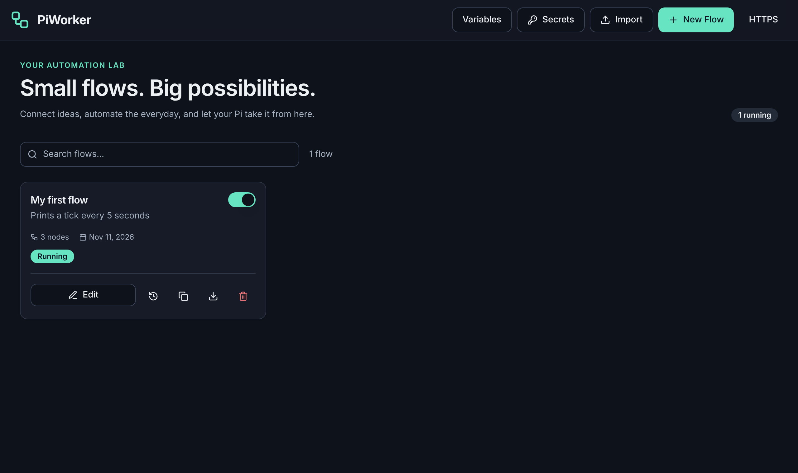

# Getting started

By the end of this page PiWorker is installed, you are signed in, and a flow
you built is running. It takes about ten minutes.

1. [Install PiWorker](#1-install-piworker)
2. [Open it in your browser](#2-open-it-in-your-browser)
3. [Create your account](#3-create-your-account)
4. [Build your first flow](#4-build-your-first-flow)
5. [Run it and watch it work](#5-run-it-and-watch-it-work)
6. [Make it useful](#6-make-it-useful)

## 1. Install PiWorker

Pick the option that matches your machine.

### Raspberry Pi or another Linux machine (recommended)

Needs Linux with systemd (Raspberry Pi OS Bookworm, Debian 12, Ubuntu 22.04 or
newer) on a 64-bit or 32-bit ARM board or a PC.

```bash
curl -fL https://github.com/Pegasus8/piworker/releases/latest/download/piworkerctl -o piworkerctl
sudo bash ./piworkerctl install
```

The installer downloads PiWorker, checks its checksum, starts it as a service
that survives reboots, and prints two things to keep at hand:

- the **address**, for example `https://raspberrypi.local:8443`;
- the **CA fingerprint**, a line starting with `SHA256:`.

### Docker

```bash
docker run -d --name piworker --restart unless-stopped \
  -p 8443:8443 -p 8080:8080 \
  -v piworker-data:/app/data \
  -e PIWORKER_TLS_HOSTS=raspberrypi.local,192.168.1.50 \
  -e PIWORKER_ALLOWED_HOSTS=raspberrypi,raspberrypi.local \
  ghcr.io/pegasus8/piworker:latest
```

Replace `raspberrypi.local`, `raspberrypi` and `192.168.1.50` with the name and
address you type in the browser to reach the Docker host: a container cannot
find them out by itself. The address is then `https://<that name>:8443`.

### Build it yourself

See [Build from source](../../README.md#option-3-build-from-source).

> **Prepublication notice.** The commands above install the latest *stable*
> release. While PiWorker is only published as a prerelease, install it by
> tag as shown under
> [Install, update and uninstall](../../README.md#install-update-and-uninstall-linux--raspberry-pi),
> and use that tag instead of `latest` for the Docker image. Before any
> release exists, build from source.

> **Used the 2020 version of PiWorker?** This is a new program. It does not
> read the old tasks or database, so install it separately and recreate your
> automations as flows.

## 2. Open it in your browser

Open the address the installer printed. If you type `http://<device>:8080`
instead, PiWorker sends you to the HTTPS address.

**The browser shows a certificate warning the first time. This is expected.**
PiWorker encrypts the connection with a certificate it created itself, and your
browser does not know it yet. You have two choices:

- **Just trying it out:** continue past the warning (*Advanced → Proceed*).
  The connection is encrypted, but the browser cannot confirm it is really your
  Pi.
- **Using it for real:** open **Trust this device** (the **HTTPS** link at the
  top of PiWorker, or `/trust`). It gives you the certificate file and
  step-by-step instructions for macOS, Windows, Linux, iPhone/iPad, Android
  and Firefox. Compare the fingerprint on that page with the one the installer
  printed; if they match, install it. You do this once per device, and the
  warning never comes back.

Cannot connect at all? See [Troubleshooting](troubleshooting.md#i-cannot-open-piworker).

## 3. Create your account

A new installation asks for a **setup code**. PiWorker prints it when it
starts, so only someone with access to the machine can create the account:

| Installed with | Get the code with |
|----------------|-------------------|
| `piworkerctl` | `sudo journalctl -u piworker -n 50 --no-pager` |
| Docker | `docker logs piworker` |
| A binary you started yourself | Look at the terminal where it runs |

Type the code, choose a username and a password, and the flow list opens. The
code works once and expires after 30 minutes; if it expired, restart PiWorker
to get a new one.

## 4. Build your first flow

The flow prints a message every five seconds. It needs nothing but PiWorker,
so it works on any machine.

**Create the flow.** Choose **New Flow**. The editor opens with the node list
on the left and an empty canvas.

**Add three nodes.** Click a node in the list to add it (or drag it onto the
canvas). Each time, its settings open; fill them in and choose **Apply
changes**.

| Add this node (section) | Setting | Value |
|-------------------------|---------|-------|
| **Interval Timer** (Triggers) | Interval (ms) | `5000` |
| **Template** (Processing) | Template | `Tick number {{payload.count}}` |
| **Debug** (Processing) | – | leave as it is |

The timer produces a message every 5 seconds with a counter in
`payload.count`. The template turns it into a sentence. Debug shows whatever
reaches it.

**Try a node before running anything.** The settings of a processing node
include a **Payload playground**: paste a sample message, choose **Test node**
and see exactly what the node would output. Nothing is deployed and nothing is
saved.



**Connect them.** Drag from the dot on the right edge of **Interval Timer** to
the dot on the left edge of **Template**, then from **Template** to **Debug**.
On a phone or if dragging is awkward, use **Connections** above the node list
and pick the nodes from the lists instead.

**Name and save.** Choose **Settings**, type a name such as `My first flow`,
then **Done** and **Save**.



## 5. Run it and watch it work

Choose **Deploy**. The badge at the top changes from **Stopped** to
**Running**.

Open **Activity** at the bottom of the editor:

- **Debug** shows the messages reaching your Debug node, live:
  `"payload": "Tick number 1"`, then 2, 3…
- **Runs** lists every execution with its result. Open one to see which nodes
  ran, how long each took, and any error.



The flow now runs on its own: you can close the browser, and it starts again
after a reboot. To change it, choose **Stop**, edit, **Save** and **Deploy**
again. The switch on each card of the flow list does the same as Deploy and
Stop.



## 6. Make it useful

Replace the pieces one at a time:

- **A different trigger.** Swap Interval Timer for **Cron Schedule** (every
  day at 9:00 is `0 9 * * *`), **Webhook** (another service calls a URL),
  **System Metric** (the Pi gets too hot) or a sensor.
- **A real action.** Swap Debug for **Notify** (Discord, Slack or ntfy),
  **Telegram**, **Email**, **HTTP Request** or **GPIO Write**.
- **A decision.** Put a **Filter** or a **Switch (If/Else)** in between so the
  action only happens when a condition holds, such as
  `payload.temperature > 30`.

Where to go next:

- [Recipes](recipes.md) has complete flows you can copy.
- [Concepts](concepts.md) explains messages, expressions and templates,
  variables and secrets.
- [Node reference](nodes.md) lists every node and setting.
